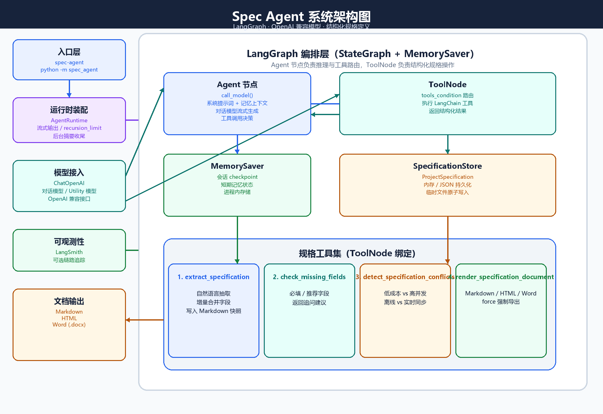
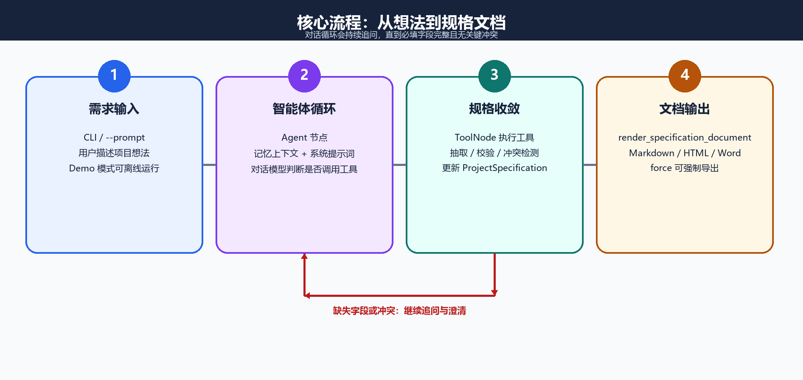
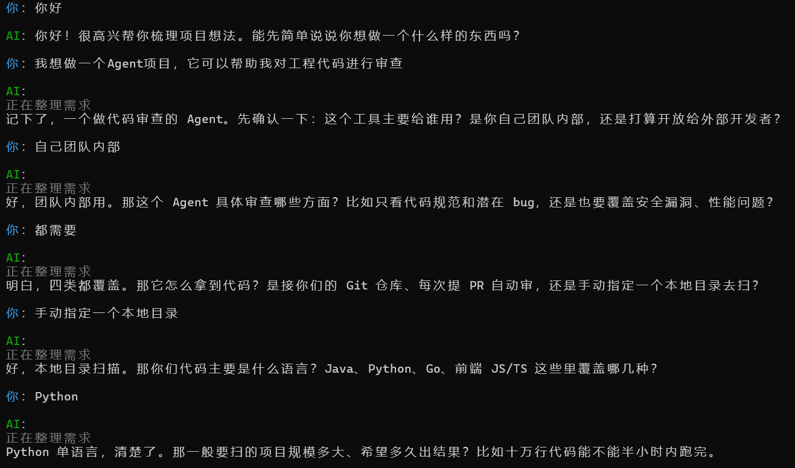
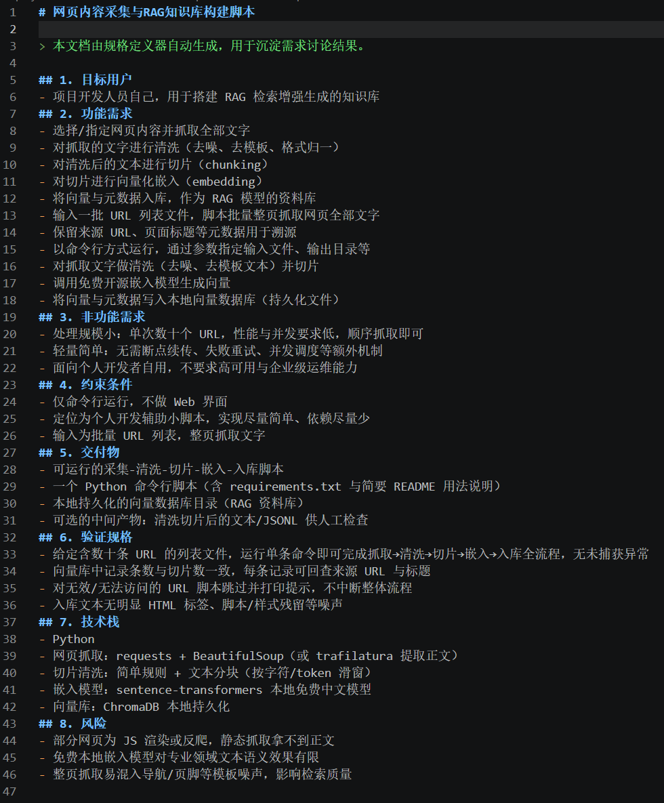

# Spec Agent

> 一个使用 LangGraph `StateGraph + ToolNode` 显式构建的 AI 项目规格定义器。
> 它通过 OpenAI 兼容接口调用任意兼容模型，把零散的产品想法逐步收敛成结构化规格，
> 并自动检查缺失项、内部冲突，最终导出 Markdown、HTML 或 Word 文档。


## 项目引言

在 AI 辅助开发的时代，手写编码的工作量大幅缩减，项目瓶颈不再是敲代码，而是**把模糊想法转化为严谨、无歧义的项目规格**。AI 能快速产出代码，但天然无法读懂开发者脑中的隐含需求，极易出现需求跑偏、实现不符合预期的问题。

Spec Agent 是对话式规格定义智能体，作为整套 AI 开发工作流的首个核心模块。它承接开发者零散、抽象的想法，通过交互式对话，梳理目标、功能边界、约束条件、输入输出规范，输出标准化项目 spec 文档。
spec 是项目的灵魂，后续代码生成、校验、重构环节全部以此为唯一基准。spec Agent 解决 “需求说不清” 的痛点，为后续创造、检查、清理的闭环开发流程筑牢根基，让 AI 编程从即兴生成，变成可管控、可验收的工程化项目交付。

## 它能做什么

用户在 CLI 中描述一个项目想法，智能体会逐步追问并抽取以下信息：

- 项目名称
- 目标用户
- 功能需求
- 非功能需求
- 约束条件
- 交付物
- 验证规格
- 技术栈
- 风险

当必填字段完整且没有关键冲突后，可以导出最终规格定义文档。

## 快速开始

### 环境要求

- Python 3.10+

### 1. 配置环境变量

Linux / macOS：

```bash
cp .env.example .env
```

Windows PowerShell：

```powershell
Copy-Item .env.example .env
```

编辑 `.env`，至少填入 `LLM_API_KEY`、 `LLM_MODEL` 和 `LLM_BASE_URL`。

### 2. 安装

```bash
python -m pip install -e .
```

Windows PowerShell 使用相同命令。`requirements.txt` 仅保留 editable 安装入口，真正的依赖来源是 `pyproject.toml`。

### 3. 启动交互式对话

```bash
spec-agent
```

也可以使用模块方式启动：

```bash
python -m spec_agent
```

输入 `exit`、`quit` 或 `退出` 可以结束程序。

## 输出目录

默认输出目录：

```text
output/
└── default/
    ├── specification.md
    ├── specification.html
    └── specification.docx
```

同一个 `output` 根目录下，不同 `project_id` 会使用独立子目录，避免互相覆盖。

## 架构图




## 核心流程



多轮对话会形成一个闭环：用户补充信息 → Agent 决定是否需要调用工具 → ToolNode
更新结构化规格 → 返回缺失项或冲突 → 继续追问，直到规格达到可交付状态。

## 使用预览



## 输出预览



> 上图为模板渲染效果示例，实际内容会根据用户对话逐步填充。

## 核心特性

### 1. 显式的 LangGraph 图结构

项目没有把模型调用、工具调用和状态更新混在一起，而是使用：

- `StateGraph`：定义 Agent 节点和工具节点。
- `ToolNode`：统一执行规格工具。
- `tools_condition`：根据模型是否请求工具来决定路由。
- `MemorySaver`：保存当前会话 checkpoint。

### 2. 模型供应商解耦

使用 `ChatOpenAI` 访问 OpenAI 兼容接口,切换模型只需修改 `.env`：

```dotenv
LLM_API_KEY=sk-your-api-key
LLM_MODEL=your-llm-model
LLM_BASE_URL=your-llm-base-url
```

对话模型与 utility 模型可以分开配置，抽取和摘要任务默认使用更低温度，便于提高结构化输出稳定性。

### 3. 增量规格抽取

`extract_specification` 每轮从用户输入中抽取**新增或修正信息**，避免旧信息被模型遗漏时丢失。支持：

- 列表字段增量合并；
- 删除已有条目；
- 用户明确覆盖时整体替换列表；
- 对“项目名称叫 X”“技术栈用 A、B”等高确定性短输入做本地快速抽取，减少额外 LLM 调用。

### 4. 缺失项检查与冲突检测

`check_missing_fields` 区分必填字段和推荐字段，并返回追问话术。

`detect_specification_conflicts` 内置常见需求矛盾检查，例如：

- 低成本 vs 高并发；
- 离线可用 vs 实时同步。

### 5. 多格式文档导出

通过 Jinja2 模板和 `python-docx` 生成：

```text
output/default/specification.md
output/default/specification.html
output/default/specification.docx
```

必填字段未完成或存在冲突时，工具会返回 `blocked`；可以通过 `force=true` 强制导出。

### 6. 短期记忆与后台摘要

- 最近消息会完整保留在提示词中。
- 超过 token 窗口的旧消息会被压缩成摘要。
- 回复完成后在后台更新摘要，不阻塞首字流式输出。
- 当前版本只使用进程内 `MemorySaver`，不会写入 `agent_memory.db`。

### 7. 可选 JSON 持久化

默认会话使用内存存储，适合演示和一次性任务。传入 `--storage` 后，规格对象会同步写入 JSON，下次可以继续编辑：

```powershell
spec-agent --storage output/my-project.json --project my-project
```

## CLI 参数

| 参数 | 说明 |
| --- | --- |
| `--prompt` | 非交互模式：只处理一条输入后退出 |
| `--demo` | 使用本地 Fake LLM，无需 API Key |
| `--storage PATH` | 规格 JSON 持久化文件路径 |
| `--project ID` | 项目 ID，默认 `default` |

## 规格工具

| 工具 | 作用 | 典型返回值 |
| --- | --- | --- |
| `extract_specification` | 抽取并增量合并用户输入 | 更新状态、Markdown 快照路径、缺失项、冲突项 |
| `check_missing_fields` | 检查必填和推荐字段 | 是否完整、缺失项、追问建议 |
| `detect_specification_conflicts` | 检测规格内部矛盾 | 是否存在冲突、冲突详情、澄清建议 |
| `render_specification_document` | 导出最终文档 | 渲染结果、格式、文件路径，或 `blocked` |


## 环境变量

关键配置如下，完整示例见 [`.env.example`](.env.example)。

| 变量名 | 必填 | 说明 |
| --- | --- | --- |
| `LLM_API_KEY` | 是 |  API Key |
| `LLM_MODEL` | 是 | 对话模型名称 |
| `LLM_BASE_URL` | 是 | OpenAI 兼容接口地址 |
| `LLM_UTILITY_MODEL` | 否 | 抽取/摘要工具使用的模型；为空时复用 `LLM_MODEL` |
| `LLM_CONTEXT_WINDOW` | 否 | 用于自动计算历史窗口的上下文窗口大小，默认 `65536` |
| `SPEC_AGENT_USER_ROLE` | 否 | 用户身份提示词，默认 `项目开发人员` |
| `SPEC_AGENT_SCENE_RULE` | 否 | 场景约束提示词 |
| `SPEC_AGENT_MAX_HISTORY_TOKENS` | 否 | 历史窗口 token 上限，默认按上下文窗口自动计算 |
| `SPEC_AGENT_RECURSION_LIMIT` | 否 | 单轮图递归上限，默认 `4` |
| `SPEC_AGENT_TIMING` | 否 | 设为 `1` 时输出分阶段耗时日志 |
| `LANGSMITH_TRACING` | 否 | 设为 `true` 时启用 LangSmith 追踪 |
| `LANGSMITH_API_KEY` | 否 | LangSmith API Key |
| `LANGSMITH_PROJECT` | 否 | LangSmith 项目名称 |

温度、超时、重试等参数请参考 `.env.example`。

## 项目结构

```text
.
├── .env.example
├── .github/
│   └── workflows/ci.yml
├── docs/
│   └── architecture.md
├── images/
│   ├── architecture.png
│   ├── workflow.png
│   ├── output-preview.png
│   └── README.md
├── src/
│   └── spec_agent/
│       ├── __init__.py
│       ├── __main__.py
│       ├── agent.py
│       ├── runtime.py
│       ├── llm.py
│       ├── graph.py
│       ├── memory.py
│       ├── tokenizer.py
│       ├── history_window.py
│       ├── message_sanitizer.py
│       ├── summarizer.py
│       ├── messages.py
│       ├── prompts.py
│       ├── config.py
│       ├── chat_ui.py
│       ├── demo.py
│       ├── cli.py
│       └── tools/
│           ├── schemas.py
│           ├── store.py
│           ├── extraction.py
│           ├── validation.py
│           ├── conflicts.py
│           ├── rendering.py
│           ├── registry.py
│           └── templates/
│               ├── specification.md.j2
│               └── specification.html.j2
├── tests/
├── pyproject.toml
├── requirements.txt
└── LICENSE
```

## 开发与测试

安装开发依赖：

```bash
python -m pip install -e ".[dev]"
```

运行测试和覆盖率：

```bash
python -m pytest --cov=spec_agent --cov-report=term-missing
```

代码检查与类型检查：

```bash
ruff check src tests
mypy src
```

CI 会使用 Python 3.10 和 3.11 运行 `ruff`、`mypy` 与 pytest，并要求测试覆盖率不低于 70%。

## 扩展方式

新增规格工具时，建议保持“纯逻辑服务 + 工具包装”的边界：

1. 在 `tools/` 中实现纯 Python 业务逻辑；
2. 在 `tools/registry.py` 的 `build_specification_toolkit()` 中注册为 LangChain 工具；
3. 在 `runtime.py` 中完成依赖注入；
4. 如有新的结构化字段，同步更新 `tools/schemas.py` 和渲染模板。

## Roadmap

- 增加 Web UI，让产品经理无需接触命令行；
- 支持多个项目会话管理与历史记录恢复；
- 引入更强的记忆层，例如向量检索或数据库持久化；
- 增加更丰富的规格字段和行业模板；
- 提供 FastAPI 接口，将规格智能体封装为服务。

## License

[MIT](LICENSE)
